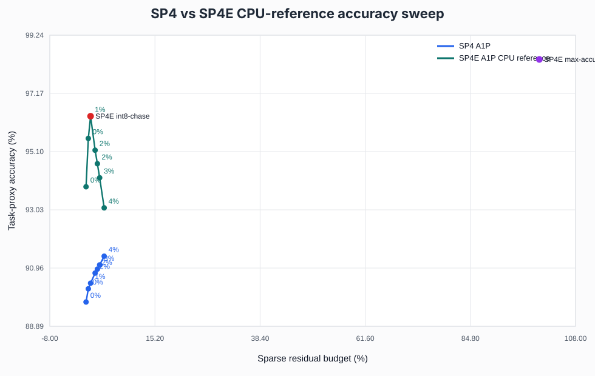
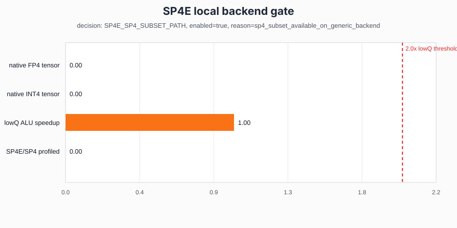
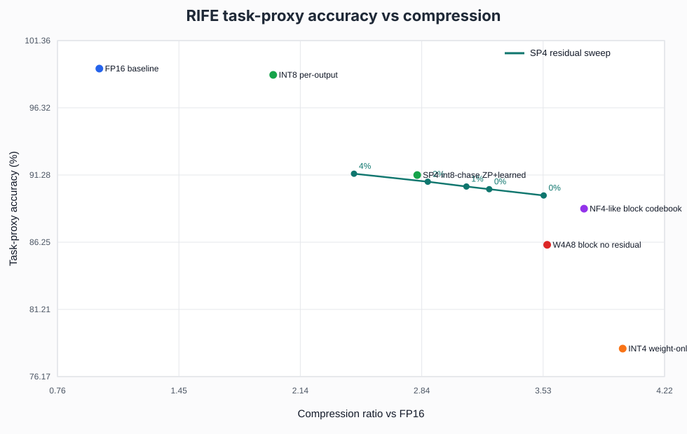
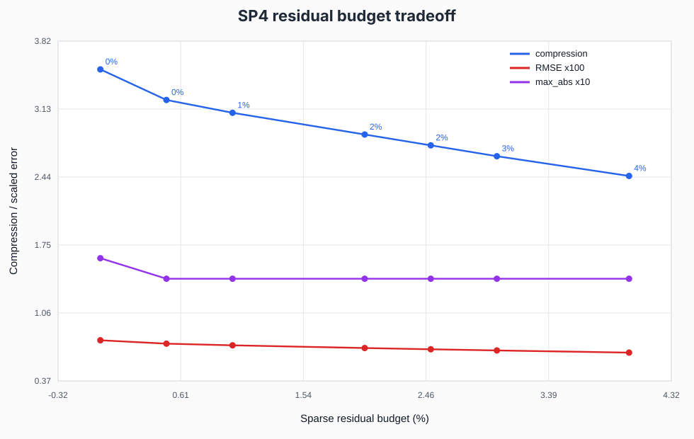
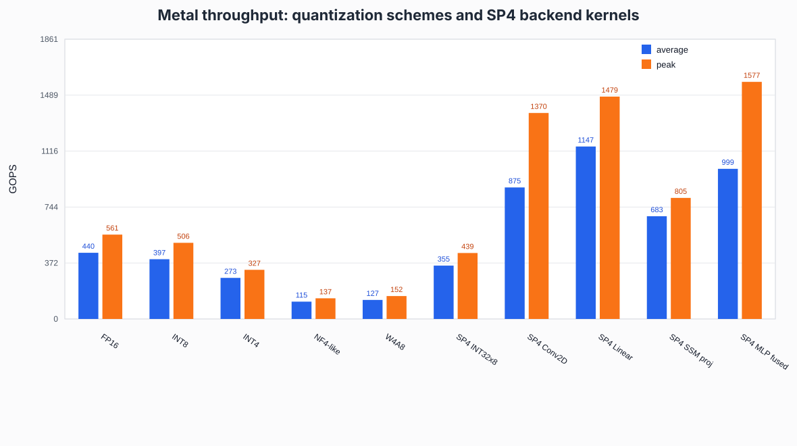
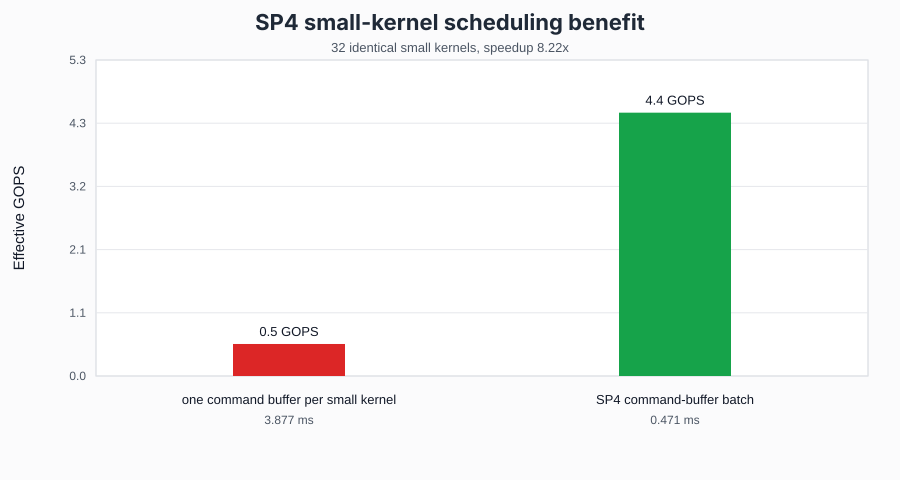

# Stellaria SP4

> **Frozen historical repository (2026-09).** SP4/SP4E is now maintained only
> under the [`Stellaria-BasicX` `main` branch](https://github.com/Stellaria-Studio/Stellaria-BasicX/tree/main/runtime/src/RHI/Extensions/Stellaria%20SPX/Stellaria%20SP4).
> This repository remains as a reproducible history snapshot. New products must
> link `Stellaria_BasicX_SP4` and must not develop or vendor this copy.

Stellaria SP4 is a low-precision inference SDK from **Stellaria Studio**. It is built for visual models and Stellaria-owned project adaptation, with a practical goal: let GPUs and other hardware without dedicated low-precision matrix accelerators still benefit from 4-bit-style compression and throughput.

SP4 is not only a quantization recipe. It is a compiler, asset format, runtime ABI, and Metal/Slang backend contract for executing W4A8-style visual inference with project-aware accuracy recovery.

## SP4E Development Preview

SP4E is the in-development C++ extension layer for SP4. It explores FP4 / INT4 mixed assets, SP4-subset fallback, and future matrix-accelerated backends while keeping the existing SP4 toolchain usable on ordinary hardware:

```text
SP4E-F4I4block16(A1P)
SP4E-F4I4tile16x16(A1P)
```

The SP4E path is not considered production-frozen yet. The repository currently includes the C++ compiler, asset container, loader, inspector, CPU reference reconstruction, CPU reference Conv2D/Linear operators, backend gate metadata, and generated comparison charts. Python remains useful for SP4 research and regression helpers, but SP4E core compile/load/reference behavior is C++ because this is runtime and HPC infrastructure.

SP4 is treated as an SP4E subset. On machines without FP4 matrix acceleration, INT4-compatible and asymmetric zero-point blocks route through the SP4 subset path while FP4 and correction-sensitive blocks use the SP4E reference or future tensor paths. The expected generic-host decision is `SP4E_SP4_SUBSET_PATH`.

```bash
cmake -S . -B build-sdk
cmake --build build-sdk
./build-sdk/sp4ec compile --input model.safetensors --output model.sp4e --adapter generic
./build-sdk/sp4einspect-cpp model.sp4e
```

See [docs/SP4E_SYSTEM_DEFINITION.md](docs/SP4E_SYSTEM_DEFINITION.md).

Generated local SP4E comparison charts are included so the development preview is measured against the same public RIFE task-proxy as SP4:





## What It Is For

- Visual inference and video models where artifacts matter more than a single scalar RMSE.
- Hardware paths that have strong integer/FP ALUs and memory bandwidth, but no special INT4/NVFP4 tensor accelerator.
- Project-level adaptation: RIFE/video interpolation first, with MLP and SSM backend paths already present for broader model support.
- Mixed precision execution: SP4 for dense quantization-friendly work, FP16/custom kernels for operators that should not be forced into 4-bit.

## Experimental Platform

All numbers below were produced locally on:

```text
Apple M4 Pro
20-core GPU
48 GB unified memory
Metal backend
RIFE safetensors model
```

Run the same local validation with:

```bash
./tools/validate_backends.sh
python3 tools/generate_comparison_charts.py
```

The RIFE model weights are not included in this repository. For local validation, copy `Models/RIFE-safetensors` from the Stellaria Motion workspace or provide an equivalent safetensors model.

## Results

### Quality And Compression

`task_acc` is a public RIFE task-proxy score. It reconstructs quantized convolution layers, runs deterministic motion-boundary and edge-sensitive INT8 probe patches through teacher and candidate weights, then reports:

```text
task_acc = 100 * (1 - weighted_relative_l2 - min(0.20, 0.35 * edge_relative_l2))
```

This is not a full video MOS/LPIPS benchmark. It is designed to expose the kinds of motion-boundary and edge errors that are visible in interpolation.

| Scheme | Compression | RMSE | MAE | Max abs | Task acc |
| --- | ---: | ---: | ---: | ---: | ---: |
| FP16 baseline | 1.00x | 0.000557 | 0.000017 | 0.249917 | 99.26% |
| INT8 per-output | 1.99x | 0.000942 | 0.000752 | 0.008430 | 98.79% |
| INT4 weight-only | 3.98x | 0.016821 | 0.013540 | 0.159035 | 78.27% |
| NF4-like block codebook | 3.76x | 0.008428 | 0.006394 | 0.268344 | 88.76% |
| W4A8 block, no residual | 3.55x | 0.010679 | 0.008472 | 0.159035 | 86.05% |
| SP4 adaptive sparse residual | 2.87x | 0.007060 | 0.005583 | 0.140825 | 90.78% |
| SP4 int8-chase ZP+learned | 2.81x | 0.006678 | 0.005346 | 0.187433 | 91.28% |
| SP4E A1P development preview, 2x-constrained | 2.12x | 0.004722 | 0.003660 | 0.195697 | 96.36% |

The honest tradeoff: INT8 is still the accuracy target to chase, while SP4 keeps much of the compression and backend-friendly execution behavior of 4-bit quantization. SP4E is the higher-accuracy development path: in the current 2x-constrained RIFE task-proxy point, it keeps better-than-INT8 compression and closes a substantial part of the task-accuracy gap. The current SP4E result uses packed control nibbles, compact sparse residual tables, L2-optimized block scales, task-ranked sparse residuals, rank-4 FP16 low-rank correction, and per-output channel gain correction.





### Metal Throughput

| Kernel / scheme | Average GOPS | Peak GOPS |
| --- | ---: | ---: |
| FP16 synthetic | 406.794 | 565.037 |
| INT8 per-output synthetic | 380.205 | 482.194 |
| INT4 per-output synthetic | 256.032 | 309.081 |
| NF4-like synthetic | 116.193 | 137.764 |
| W4A8 block synthetic | 131.318 | 153.672 |
| SP4 INT32x8 synthetic | 342.146 | 432.987 |
| SP4 Conv2D W4A8 Block32 | 245.412 | 272.184 |
| SP4 Conv2D W4A8 Block64 | 847.794 | 1396.950 |
| SP4 Linear Tile16 W4A8 | 1014.600 | 1437.190 |
| SP4 SSM Projection W4A8 | 647.084 | 692.439 |
| SP4 MLP fused Projection+Gate+SiLU | 1148.620 | 1705.250 |
| SP4 SSM Scan FP16 serial | 1.535 | 1.829 |
| SP4 SSM Scan Parallel512 FP16 | 3.939 | 5.307 |

The synthetic SP4 INT32x8 path groups 4-bit work into integer ALU batches, then restores scale/correction through FP16/FP32 paths at block/tile boundaries. The high-throughput SP4 Linear, SSM projection, and fused MLP rows are specialized backend kernels; they show why SP4 is a runtime/backend contract rather than only a storage format. Short Metal kernel timings vary between runs; the table and chart are regenerated by `python3 tools/generate_comparison_charts.py`.



### Scheduling Benefit

Stellaria Motion exposed a common realtime problem: many small kernels can lose most of their theoretical throughput to command-buffer boundaries and CPU/GPU synchronization. SP4 therefore carries batch, reuse, fusion, tile, and output-slot metadata in the backend ABI.

The current Metal scheduling microbenchmark dispatches 32 identical small MLP epilogue kernels:

| Schedule | Time | Effective GOPS |
| --- | ---: | ---: |
| One command buffer per small kernel | 3.878 ms | 0.541 |
| SP4 command-buffer batch | 0.471 ms | 4.448 |

That is an **8.22x** effective throughput lift in the generated comparison run. A full backend validation pass in the same session measured a 22.17x lift, so the stable conclusion is that command-buffer batching is a first-order optimization for realtime SP4 graph execution.



Raw generated metrics are in [docs/assets/sp4_comparison_metrics.json](docs/assets/sp4_comparison_metrics.json).

## Technical Principle

SP4 combines a compact 4-bit main path with explicit accuracy recovery:

- Packed INT4 weights and INT8 activation contracts reduce bandwidth.
- Block FP16 scales restore the main signal.
- Asymmetric zero-point blocks handle skewed distributions.
- Learned/project codebooks handle distribution-shaped visual weights.
- Sparse FP16 residual entries repair sensitive weights and blocks.
- Backend plans keep dispatch predictable for Metal and Slang.
- Fused kernels avoid launch overhead for common MLP/SSM/RIFE patterns.
- SP4E extends this with selected FP4/INT4 block16 main planes, packed per-block control nibbles, SP4-subset fallback, low-rank residual sidecars, and channel correction metadata for future matrix backends.

The runtime does not guess. The compiler chooses block modes offline, writes fixed metadata into the `.sp4` asset, and the backend executes that plan.

## Quick Start

```bash
cmake -S . -B build-sdk
cmake --build build-sdk

./build-sdk/sp4c compile \
  --input Models/RIFE-safetensors/flownet.safetensors \
  --output build/rife_cpp.sp4 \
  --adapter rife \
  --target metal-m4pro \
  --quality-profile adaptive-rife

python3 -m sp4_toolchain validate \
  build/rife_cpp.sp4 \
  --teacher Models/RIFE-safetensors/flownet.safetensors
```

High-accuracy profile:

```bash
SP4_QUALITY_PROFILE=int8-chase ./tools/validate_backends.sh build/rife_int8_chase.sp4
```

## Repository Layout

- `sdk/`: C++ compiler, runtime loader, inspectors, Metal validation tools.
- `sp4_toolchain/`: Python research/compiler/validator utilities.
- `shaders/metal/`: Metal backend kernels.
- `shaders/slang/`: Slang backend kernels for portable backend development.
- `docs/`: format, backend, validation, comparison, and original SP4 definition docs.
- `tools/`: reproducible validation and chart generation scripts.

## License

SP4 is released under the **GNU Affero General Public License v3.0 or later**.

Copyright (C) 2026 Stellaria Studio.
