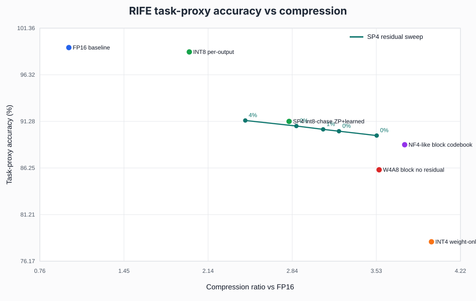
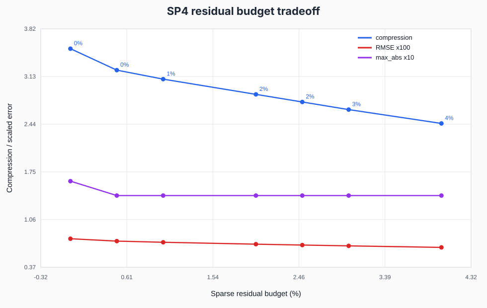
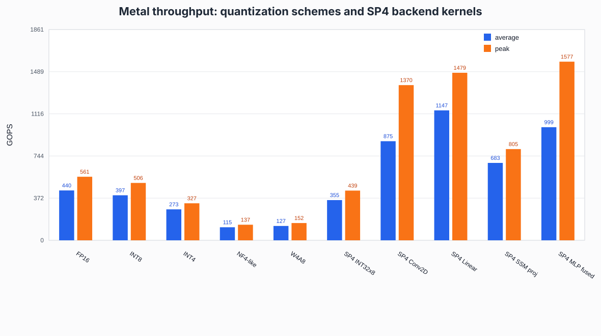

# SP4 Compared With Nearby Quantization Schemes

SP4 is not just a smaller weight format. It is a runtime ABI for visual inference.

| Scheme | Typical Goal | Runtime Metadata | Residual Path | Project Adapter | Visual/Temporal Focus |
| --- | --- | --- | --- | --- | --- |
| Weight-only INT4 | Reduce model size | Minimal | No | No | Usually weak |
| W4A8 | Lower bandwidth and compute | Usually per-channel/block scale | Usually no | Rare | Task-dependent |
| W4A16 | Preserve activation quality | Weight scale only | Usually no | Rare | Better quality, less speed |
| NF4 / codebook | Better distribution fit | Codebook/LUT | Usually no | No | Good for some weight distributions |
| GPTQ/AWQ-style | LLM accuracy retention | Layer/group quant metadata | No visual residual contract | LLM-centric | Not video/artifact-centric |
| SP4 A1P | Runtime visual inference | block mode, aux, scale, residual table, backend plan | Yes, sparse FP16 | Yes | Core design goal |

## SP4 Advantages

SP4 keeps the useful part of W4A8, then adds runtime-oriented controls:

```text
INT4 weight bandwidth reduction
INT8 activation contract
FP16 scale restore
sparse FP16 correction for sensitive blocks
project-owned aux metadata
compile-time block policy
runtime fixed backend plan
backend capability validation
CPU reference and quality validator
Metal native and Slang portable kernel contracts
```

For video interpolation and neural rendering, this matters more than a single compression number.

## Why Not Pure Weight-Only INT4

Weight-only INT4 is easy to pack, but it usually lacks:

```text
activation scale contract
mode metadata
residual table
project-specific sensitivity map
backend dispatch plan
artifact-aware validation
```

SP4 can spend a small amount of metadata and sparse residual bandwidth where it protects motion boundaries, masks, edges, or material response.

## Why Not Generic NF4

NF4/codebook formats can reduce statistical quantization error, but SP4 is designed around shader execution:

```text
simple nibble unpack
predictable scale multiply
byte-addressable mode/aux streams
ordinary ALU execution
future matrix backend mapping
```

The goal is not only lower RMSE. The goal is a stable runtime asset that a Metal or Slang backend can execute predictably.

## Summary

SP4's differentiator is the combination:

```text
4-bit main path
FP16 split precision recovery
sparse residual correction
project-adaptive metadata
fixed backend plan
visual artifact validation
high-performance backend contract
```

That makes SP4 closer to a private low-precision inference SDK than a standalone quantization recipe.

## Local RIFE Comparison On Apple M4 Pro

Command:

```bash
./tools/generate_comparison_charts.py
```

Current result:

```text
runtime layers: 42
teacher FP16 bytes: 4,543,830

scheme                         bytes       compression   RMSE      MAE       max_abs   task_acc
FP16 baseline                  4,543,830   1.00x         0.000557  0.000017  0.249917  99.26%
INT8 per-output                2,278,665   1.99x         0.000942  0.000752  0.008430  98.79%
INT4 weight-only per-output    1,142,709   3.98x         0.016821  0.013540  0.159035  78.27%
NF4-like block codebook        1,208,694   3.76x         0.008428  0.006394  0.268344  88.76%
W4A8 block no residual         1,280,508   3.55x         0.010679  0.008472  0.159035  86.05%
SP4 A1P sparse residual        1,583,724   2.87x         0.007060  0.005583  0.140825  90.78%
SP4 A1P int8-chase ZP+learned  1,617,396   2.81x         0.006678  0.005346  0.187433  91.28%
```

Interpretation:

```text
INT8 has the lowest error but only about 2x compression.
INT4 weight-only has the best compression but the highest average error among linear INT paths.
NF4-like codebook is compact and distribution-aware, but SP4 now folds that idea into its own `AdaptiveProject` block mode and still keeps the W4A8/INT32 fast path for ordinary blocks.
Plain W4A8 is compact and shader-friendly but has higher error than SP4.
SP4 spends metadata and sparse FP16 residual bandwidth to beat the NF4-like baseline on this RIFE task-proxy while preserving a backend-executable runtime ABI.
The `int8-chase` profile adds SP4's intrinsic zero-point mode for skewed blocks and the learned visual codebook for distribution-shaped blocks. With optimized zero-point scale search and learned codebook selection, it improves task-proxy accuracy from 90.78% to 91.28% and RMSE from 0.007060 to 0.006678, while compression drops from 2.87x to 2.81x because the profile spends more residual entries.
```

So the honest advantage is not "SP4 always wins every scalar error metric." The advantage is:

```text
artifact-oriented sparse correction
project-adaptive aux/mode metadata
fixed backend plan
Metal/Slang executable SoA layout
runtime validation and CPU reference parity
better worst-case control than the NF4-like codebook in this local RIFE test
```

## Public Task Accuracy Method

`task_acc` is intentionally public and reproducible. It is a RIFE/SP4 task-proxy, not a generic scalar weight metric:

```text
1. Reconstruct each quantized convolution layer.
2. Use the `rife_motion_boundary_v2` task profile by default.
3. Feed six deterministic INT8 probe patches: ordinary, edge alternating, motion ramp, sparse boundary, periodic ramp, and blockwise sign-change.
4. Weight early-stage, flow, mask, and convblock layers more heavily because they dominate interpolation artifacts.
5. Compute teacher output with FP32 teacher weights.
6. Compute candidate output with the quantized/reconstructed weights.
7. weighted_relative_l2 = sqrt(weighted_error_l2 / weighted_teacher_l2)
8. edge_relative_l2 = sqrt(weighted_edge_error_l2 / weighted_edge_teacher_l2)
9. task_acc = 100 * (1 - weighted_relative_l2 - min(0.20, 0.35 * edge_relative_l2))
```

This is still not a full video interpolation MOS/LPIPS/FID result. It is more aligned with SP4's goal than plain weight RMSE because it stresses motion-boundary and edge-sensitive responses that produce visible interpolation artifacts.

## Throughput

Current Metal throughput on Apple M4 Pro:

```text
scheme                    average GOPS   peak GOPS
FP16                      454.825        566.153
INT8 per-output           402.582        511.007
INT4 per-output           269.64         328.687
NF4-like                  114.033        137.355
W4A8 block                124.478        151.978
SP4 INT32x8               359.792        454.372
SP4Conv2D_W4A8_Block32    156.844        203.932
SP4Conv2D_W4A8_Block64    538.47         1556.89
SP4Linear_Tile16_W4A8     1183.49        1784.28
SP4SSM_Projection_W4A8    689.873        823.983
SP4MLP_Gated_Tile16_W4A8  21.8584        24.4625
SP4MLP_FusedGateSiLU      1615.11        2434.79
SP4SSM_Scan_FP16 serial   1.37958        1.97643
SP4SSM_Scan_Parallel512   5.69827        6.20001
```

These numbers are from executed Metal dispatches, not only shader compilation. The first six rows are same-shape synthetic comparison kernels for common quantization layouts; the SP4 Conv2D rows are real A1P backend kernel families on RIFE layer shapes using 16-pixel tiling, INT32 grouped accumulation, and block-boundary FP correction. The Linear/SSM/MLP rows are synthetic dispatch benchmarks with CPU numeric references. Short kernel timings vary between runs, so rerun `./tools/validate_backends.sh` for the current source of truth on this machine.

## Curves







Raw generated metrics are stored in [sp4_comparison_metrics.json](/Users/minsawa/Documents/Stellaria%20SP4/docs/assets/sp4_comparison_metrics.json).

## Ways To Improve Compression And Precision

## How SP4 Can Approach INT8 / NVFP4 Accuracy

SP4 should not try to become one fixed 4-bit recipe. The path toward INT8/NVFP4-like task accuracy is a mixed project-adaptive policy:

```text
activation-aware calibration:
  choose block modes and scales from real project frames/tokens, not only weight histograms

per-block format choice:
  linear W4A8 for fast ordinary blocks
  AdaptiveProject/codebook for distribution-shaped blocks
  future NVFP4-like mini-float mode for blocks where exponent range beats linear/codebook

outlier isolation:
  split outlier channels or blocks into sparse residual, INT8, or FP16 fallback

residual sharing:
  apply one FP16/FP32 correction at block/tile boundary so one calibration read corrects many approximate INT4 products

task-profile scoring:
  optimize for RIFE motion-boundary, MLP activation sensitivity, or SSM recurrence stability instead of generic RMSE

mixed backend routing:
  use SP4 for dense projections/convs and use FP16/custom kernels for graph ops whose error would dominate visible quality
```

In short, the target is not "SP4 everywhere." The target is "SP4 where 4-bit is efficient, and project-selected precision where 4-bit would be the wrong tool."

Compression improvements:

```text
entropy-code qweight/mode/aux streams after block packing
compact residual table is implemented as sparse_triplet_v1
residual local indices are implemented as u8_local_index_v1
delta-code residual indices for future cross-block entropy coding
share scale records across low-variance neighboring blocks
use mixed block sizes such as 32/64/128 by layer sensitivity
store residual tables per sensitive layer instead of globally when it saves index width
add structured sparsity or channel pruning before SP4 packing
allow NF4/codebook mode only for layers where validation proves it helps
```

Precision improvements:

```text
calibrate activation scales with real task frames, not only synthetic ranges
allocate residual budget by output_relative_l2 rather than a flat global ratio
split outlier channels into SensitiveFp16 or sparse residual blocks
keep AdaptiveProject codebook mode for blocks where offline validation beats optimized linear W4A8
run bias correction after quantization
use cross-layer equalization before SP4 compile
add learned residual selection from a small calibration set
support asymmetric zero-point mode for skewed layers
```

Implemented high-accuracy SP4-intrinsic path:

```text
mode 1: SP4_MODE_LINEAR_W4A8_ZP
per-block zero point: aux & 0x0F
offline selection: search zero point and solve scale with least-squares refinement
mode 6: SP4_MODE_LEARNED_PROJECT
learned visual codebook: 16-entry codebook fit on block-normalized RIFE/visual weights
Metal dot formula: sum(u4 * int8) - zero_point * sum(int8)
default use: adaptive-rife / max-accuracy / int8-chase profiles when offline block scoring proves it helps
current RIFE result: higher task_acc and lower RMSE, with a small compression tradeoff
```

Performance improvements that preserve quality:

```text
fuse conv + activation + requantize in the backend plan
fuse linear + gate + SiLU for MLP/FFN
fuse SSM projection + scan when state dependencies permit it
specialize pointwise/depthwise kernels instead of routing them through generic conv
batch identical small kernels by backend batchKey
use dependency masks for out-of-order dispatch of unrelated kernels
keep SoA buffers persistent across frames
use indirect dispatch once the graph runtime has stable tensor shapes
measure occupancy and useful-work ratio per kernel family
```
